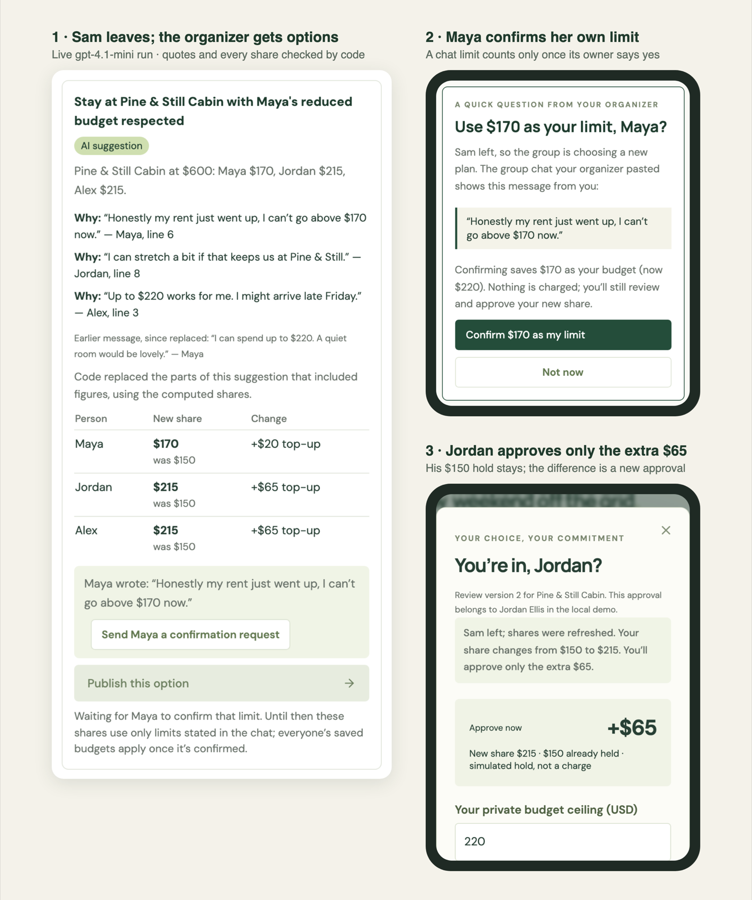

# Browser verification

Verified October 3, 2026 against the local production build.

- Four participant approvals enabled booking only after exact shares were authorized in the simulator.
- A simulated lost capture response stopped collection. Recovery reconciled and refunded the captured amounts, voided unused holds, and cancelled the fixture reservation.
- The planning parser returned source-linked drafts without changing consent or payment state.
- Missing sandbox credentials disabled sandbox order creation explicitly.
- Demo reset restored the original four-person plan.
- Desktop, 375 px phone, and 812 px landscape layouts had no horizontal page overflow. No browser console errors were observed during these flows.

These checks cover the local simulator UI. Provider execution is recorded separately in [sandbox evidence](evidence/2026-10-08-sandbox-group-refund/README.md).

## October 9 accessibility verification

Verified the current production build in a fresh local simulator.

- Opening Review and dismissing with Escape returns keyboard focus to the originating Review button.
- The close button also returns focus to Review on a 375 × 812 phone viewport.
- The review dialog measures 337 px wide, with a 375 px document width and no horizontal overflow.
- Consent terms and helper text use `#69726a`: 4.84:1 against the dialog background and 4.98:1 against white.
- The session remained at zero participant approvals; these checks exercised dialog navigation and presentation.

## October 13 recovery and interpretation verification

Verified an isolated production build with synthetic state and no provider credentials.

- Failed-refund fixture: $200 remains captured, $400 is returned, and both organizer and participant views preserve those totals. Maya's next step and row state the refund failed and requires organizer attention.
- A 375 × 812 viewport has a 375 px document width with no horizontal overflow.
- Neutral status text measures 4.51:1, next-step guidance 4.63:1, and participant secondary text 4.98:1 on their respective surfaces.
- “I already paid $50 for gas” produces **Needs clarification**, with no suggested ceiling, in the notes UI.
- Local regressions cover pending/unknown outcomes, misleading model prose and receipt-reference reconciliation after restart. The suite passes 134 tests.

This verification used fixture state; no booking, capture or refund was performed through the browser.
